# Лабораторная работа №1 — Ansible-роль для установки OpenSearch 3.8 (single-node)

## Содержание

1. [Цель работы](#1-цель-работы)
2. [Используемое окружение](#2-используемое-окружение)
3. [Структура проекта](#3-структура-проекта)
4. [Схема сети и проброс портов](#4-схема-сети-и-проброс-портов)
5. [Реализация роли](#5-реализация-роли)
6. [Параметризация роли](#6-параметризация-роли)
7. [Handlers и автозапуск](#7-handlers-и-автозапуск)
8. [Команды запуска](#8-команды-запуска)
9. [Проверка работоспособности](#9-проверка-работоспособности)
10. [Список скриншотов](#10-список-скриншотов)
11. [Возникшие сложности и их решения](#11-возникшие-сложности-и-их-решения)
12. [Вывод](#12-вывод)

---

## 1. Цель работы

Разработать Ansible-роль для установки и настройки **OpenSearch 3.8** и **OpenSearch Dashboards 3.8** в режиме **single-node** на удалённой Linux-машине без использования Docker и сторонних ролей.

---

## 2. Используемое окружение

| Компонент | Версия / параметры |
|---|---|
| Управляющая машина (control node) | Windows 10 (сборка 19045) |
| Среда запуска Ansible | WSL2, Ubuntu 24.04 LTS |
| Ansible | ansible-core 2.17.14 (установлен через `pip3 install --user`) |
| Целевая машина (managed node) | Ubuntu 26.04 LTS (GNULinux 7.0.0-38-generic, x86_64) |
| Гипервизор | Oracle VirtualBox |
| Сеть VM | NAT + проброс портов |
| Пользователь на target | `denlab` |
| OpenSearch | 3.8.0 |
| OpenSearch Dashboards | 3.8.0 |
| Режим работы | single-node |
| Тип установки | tar.gz, напрямую на хост (без Docker) |

---

## 3. Структура проекта

```
Lab1/
├── site.yml
├── inventory.ini                 # не коммитится, добавлен в .gitignore
├── inventory.ini.example         # шаблон для других пользователей
├── .gitignore
├── Screenshots/                  # скриншоты для отчёта
└── roles/
    └── opensearch/
        ├── defaults/
        │   └── main.yml
        ├── handlers/
        │   └── main.yml
        ├── meta/
        │   └── main.yml
        ├── tasks/
        │   ├── main.yml
        │   ├── install.yml
        │   ├── configure.yml
        │   ├── service.yml
        │   └── verify.yml
        ├── templates/
        │   ├── opensearch.yml.j2
        │   ├── opensearch_dashboards.yml.j2
        │   ├── jvm.options.j2
        │   ├── opensearch.service.j2
        │   └── opensearch-dashboards.service.j2
        └── README.md
```

Все стандартные директории Ansible-роли задействованы по назначению:

- **`defaults/`** — параметры роли, доступные для переопределения без правки задач;
- **`tasks/`** — логика установки, настройки, запуска и проверки;
- **`handlers/`** — перезапуск сервисов только при изменении конфигурации;
- **`templates/`** — Jinja2-шаблоны конфигов и systemd-юнитов;
- **`meta/`** — метаданные роли.

---

## 4. Схема сети и проброс портов

Используется тип сети **NAT** с пробросом портов, так как режим **Bridged Adapter** в VirtualBox не смог привязаться ни к одному физическому адаптеру Windows (поле «Имя» оставалось пустым).

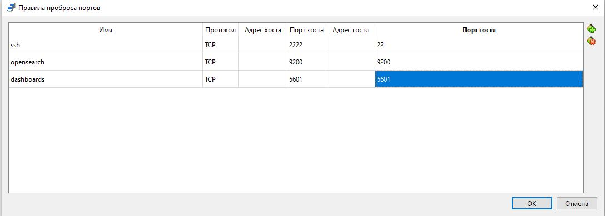

| Имя | Протокол | Порт хоста | Порт гостя | Назначение |
|---|---|---|---|---|
| `ssh` | TCP | 2222 | 22 | SSH-доступ к VM |
| `opensearch` | TCP | 9200 | 9200 | HTTP API OpenSearch |
| `dashboards` | TCP | 5601 | 5601 | Веб-интерфейс Dashboards |

Так как Ansible запускается из WSL2, а WSL2 имеет собственный loopback, обращение к проброшенным портам идёт через **IP Windows-хоста со стороны WSL** (`172.25.96.1`), а не через `127.0.0.1`.

Проверка доступности целевой машины и определение IP Windows-хоста:

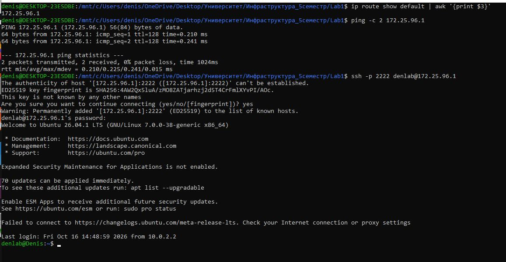

Подключение к VM напрямую из Windows через проброс:

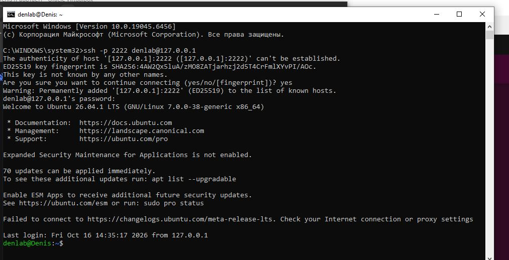

---

## 5. Реализация роли

### 5.1. `install.yml`

- Создание системного пользователя и группы `opensearch`.
- Создание каталогов `/opt`, `/etc/opensearch`, `/etc/opensearch-dashboards`, `/var/lib/...`, `/var/log/...`.
- Загрузка tarball-архивов OpenSearch 3.8 и OpenSearch Dashboards 3.8 с официального артефакт-сервера.
- Распаковка в `/opt` и создание симлинков `/opt/opensearch`, `/opt/opensearch-dashboards`.
- Копирование дефолтных конфигов в `/etc/opensearch` и `/etc/opensearch-dashboards`.

### 5.2. `configure.yml`

- Настройка `vm.max_map_count = 262144` через `ansible.builtin.command` + `ansible.builtin.lineinfile` (модуль `ansible.posix.sysctl` заменён из-за недоступности Galaxy).
- Генерация `opensearch.yml`, `jvm.options.d/heap.options`, `opensearch_dashboards.yml` из Jinja2-шаблонов.
- При изменении любого конфига срабатывает handler перезапуска соответствующего сервиса.

### 5.3. `service.yml`

- Создание systemd-юнитов `opensearch.service` и `opensearch-dashboards.service` из Jinja2-шаблонов.
- `enabled: true` — автоматический запуск после перезагрузки машины.
- `state: started` — запуск сервисов сразу после установки.

### 5.4. `verify.yml`

- Проверка готовности OpenSearch через API `GET /_cluster/health`.
- Ограниченное количество повторных попыток (`retries: 30` + `delay: 5`).
- Ожидаемый статус кластера — `green` или `yellow`.

---

## 6. Параметризация роли

Все настройки вынесены в `defaults/main.yml` и могут быть переопределены через `vars` или `--extra-vars` **без редактирования задач и шаблонов**.

| Параметр | Значение по умолчанию | Назначение |
|---|---|---|
| `opensearch_version` | `3.8.0` | Версия OpenSearch |
| `opensearch_dashboards_version` | `3.8.0` | Версия OpenSearch Dashboards |
| `opensearch_arch` | `x64` | Архитектура (`x64` / `arm64`) |
| `opensearch_cluster_name` | `opensearch-single` | Имя кластера |
| `opensearch_node_name` | `{{ inventory_hostname }}` | Имя ноды |
| `opensearch_bind_host` | `0.0.0.0` | Адрес прослушивания HTTP |
| `opensearch_http_port` | `9200` | HTTP-порт OpenSearch |
| `opensearch_transport_port` | `9300` | Transport-порт |
| `opensearch_heap_size` | `1g` | Размер heap JVM |
| `opensearch_dashboards_host` | `0.0.0.0` | Адрес Dashboards |
| `opensearch_dashboards_port` | `5601` | Порт Dashboards |
| `opensearch_security_disabled` | `true` | Отключение security-плагина |
| `opensearch_wait_retries` | `30` | Количество повторных попыток проверки API |
| `opensearch_wait_delay` | `5` | Пауза между попытками (сек) |

### Обоснование выбора параметров

- **Версия** — требование лабораторной: роль должна устанавливать выбранную версию.
- **`cluster_name` и `node_name`** — идентификация кластера и ноды, удобно менять между окружениями.
- **Порты HTTP/Transport и Dashboards** — вынесены наружу из-за возможных конфликтов.
- **`opensearch_heap_size`** — критичный параметр JVM, зависит от RAM хоста; по умолчанию `1g`.
- **`opensearch_security_disabled`** — упрощает проверку в учебной среде; в production отключать нельзя.
- **`opensearch_wait_retries` / `opensearch_wait_delay`** — гибкость на слабых машинах, где OpenSearch стартует дольше.
- **`opensearch_arch`** — позволяет использовать роль и на ARM-серверах.

---

## 7. Handlers и автозапуск

Handlers применяются для перезапуска сервисов **только при фактических изменениях**:

- `restart opensearch` — срабатывает при изменении `opensearch.yml`, heap-настроек или systemd-юнита.
- `restart opensearch-dashboards` — срабатывает при изменении `opensearch_dashboards.yml` или его systemd-юнита.
- `reload systemd` — срабатывает при изменении systemd-юнитов.

Оба сервиса включаются с `enabled: true` через модуль `ansible.builtin.systemd`, что обеспечивает автоматический запуск после перезагрузки:

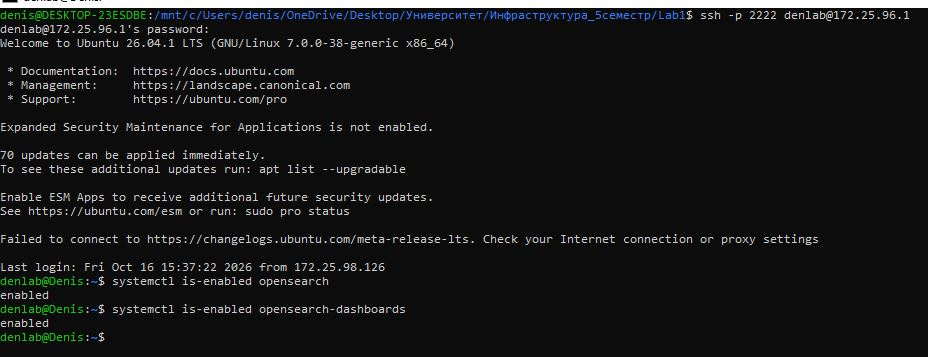

---

## 8. Команды запуска

### 8.1. Установка зависимостей (в WSL)

```bash
sudo apt update
sudo apt install -y python3-pip sshpass
pip3 install --user ansible-core
echo 'export PATH="$HOME/.local/bin:$PATH"' >> ~/.bashrc
source ~/.bashrc
```

### 8.2. Файл `inventory.ini`

Создать в корне проекта:

```ini
[opensearch]
172.25.96.1 ansible_port=2222 ansible_user=denlab ansible_password=1234 ansible_become_password=1234 ansible_ssh_common_args='-o StrictHostKeyChecking=no'
```

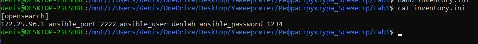

### 8.3. Файл `site.yml`

Создать в корне проекта:

```yaml
---
- name: Install OpenSearch single-node
  hosts: opensearch
  become: true
  roles:
    - opensearch
```

### 8.4. Проверка связи с целевой машиной

```bash
ansible -i inventory.ini opensearch -m ping
```

Результат — `pong`:

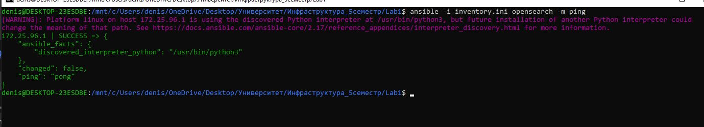

### 8.5. Запуск playbook

```bash
ansible-playbook -i inventory.ini site.yml -K
```

Флаг `-K` запрашивает пароль sudo (для пользователя `denlab` в VM).

---

## 9. Проверка работоспособности

### 9.1. Успешное выполнение playbook

Итог первого запуска: `ok=24 changed=7 unreachable=0 failed=0`.

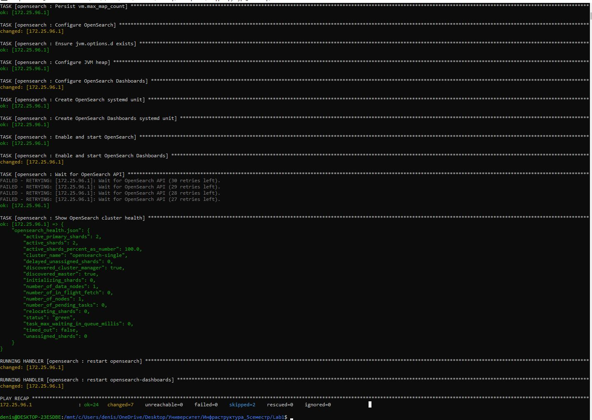

В блоке `Show OpenSearch cluster health` виден результат:

```json
"status": "green",
"number_of_nodes": 1,
"active_shards_percent_as_number": 100.0
```

### 9.2. `GET _cluster/health` через API

```bash
curl -s http://172.25.96.1:9200/_cluster/health?pretty
```

Результат:

```json
{
  "cluster_name" : "opensearch-single",
  "status" : "green",
  "timed_out" : false,
  "number_of_nodes" : 1,
  "number_of_data_nodes" : 1,
  "discovered_master" : true,
  "discovered_cluster_manager" : true,
  "active_primary_shards" : 3,
  "active_shards" : 3,
  "relocating_shards" : 0,
  "initializing_shards" : 0,
  "unassigned_shards" : 0,
  "delayed_unassigned_shards" : 0,
  "number_of_pending_tasks" : 0,
  "number_of_in_flight_fetch" : 0,
  "task_max_waiting_in_queue_millis" : 0,
  "active_shards_percent_as_number" : 100.0
}
```

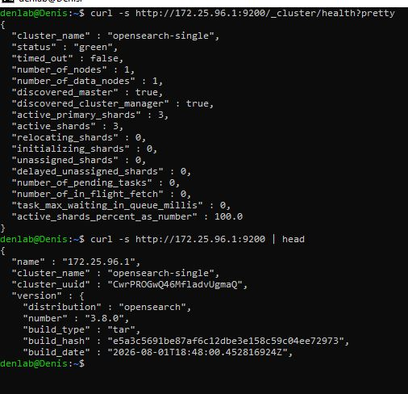

### 9.3. Проверка версии OpenSearch

```bash
curl -s http://172.25.96.1:9200 | head
```

В выводе видно `"number" : "3.8.0"` — установлена требуемая версия:

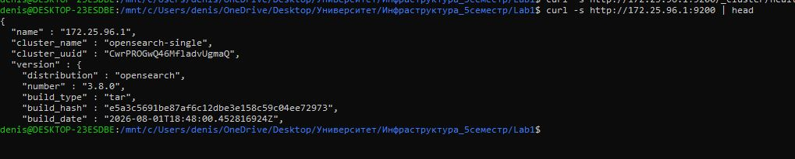

### 9.4. Статус сервиса OpenSearch

```bash
systemctl status opensearch --no-pager
```

Статус — `Active: active (running)`:

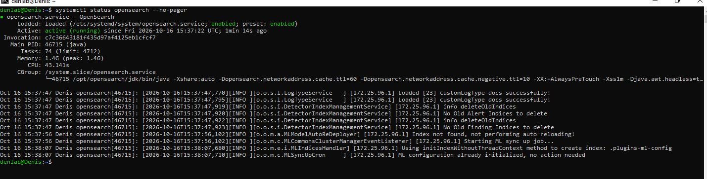

### 9.5. Проверка автозапуска

```bash
systemctl is-enabled opensearch
systemctl is-enabled opensearch-dashboards
```

Оба сервиса возвращают `enabled`:


### 9.6. OpenSearch Dashboards

Веб-интерфейс доступен на `http://127.0.0.1:5601`:

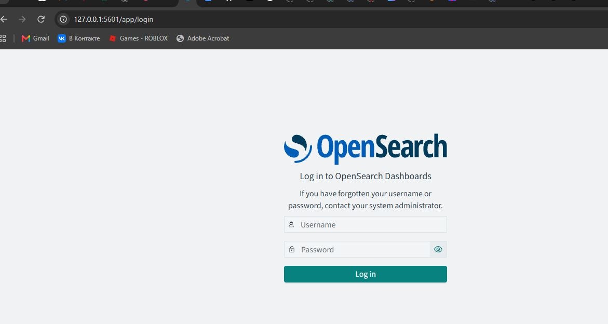

### 9.7. Идемпотентность (повторный запуск)

При повторном запуске `ansible-playbook -i inventory.ini site.yml -K` изменения минимальны, handlers не дёргаются без необходимости:

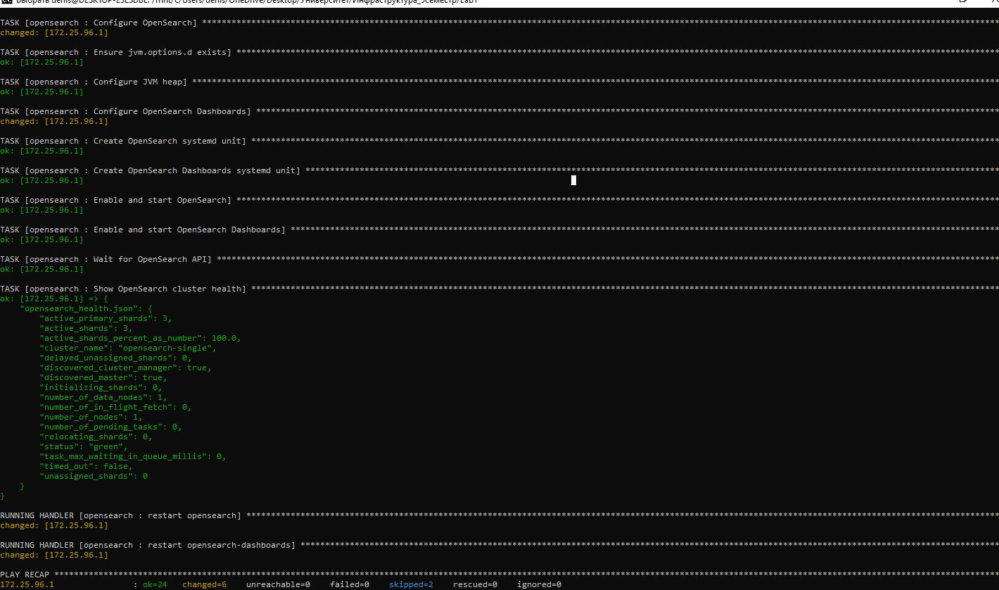


## 10. Возникшие сложности и их решения

В процессе выполнения работы пришлось решить несколько нестандартных задач.

### 10.1. Bridged Adapter не привязывался к физическому адаптеру

В VirtualBox поле «Имя» для типа подключения **Bridged Adapter** оставалось пустым — драйвер `VirtualBox Bridged Networking Driver` не был привязан ни к одному адаптеру Windows.

**Решение:** переключение на **NAT + проброс портов** (`2222→22`, `9200→9200`, `5601→5601`).

### 10.2. WSL2 и loopback Windows

Ansible из WSL2 не мог подключиться к `127.0.0.1:2222`, потому что WSL2 имеет собственный loopback.

**Решение:** использование IP Windows-хоста со стороны WSL (`172.25.96.1`), полученного через `ip route show default`.

### 10.3. Недоступность Ansible Galaxy

Модуль `ansible.posix.sysctl` требовал установки коллекции `ansible.posix`, но `galaxy.ansible.com` не отвечал.

**Решение:** замена на стандартные модули `ansible.builtin.command` + `ansible.builtin.lineinfile`.

### 10.4. Ошибка `NoClassDefFoundError` в OpenSearch 3.8

Изначально шаблон `jvm.options.j2` полностью перезаписывал оригинальный `jvm.options`, оставляя только настройки heap. Это приводило к тому, что JVM не могла загрузить `AgentPolicy` из javaagent.

**Решение:** восстановление оригинала из `/opt/opensearch/config/jvm.options` и перенос настроек heap в отдельный файл `/etc/opensearch/jvm.options.d/heap.options`, который OpenSearch подхватывает автоматически.

### 10.5. Права доступа к `/opt/opensearch-3.8.0/`

После распаковки tar.gz владельцем файлов оказался пользователь `denlab` (uid 1000 из архива), а часть конфигов имела права `640` — пользователь `opensearch` не мог их читать.

**Решение:** `sudo chown -R opensearch:opensearch /opt/opensearch-3.8.0 /opt/opensearch-dashboards-3.8.0`.

### 10.6. Таймаут ожидания API

Изначально `opensearch.service` попадал в блокировку systemd из-за `Start request repeated too quickly` (5 неудачных запусков).

**Решение:** `sudo systemctl reset-failed opensearch` для сброса счётчика попыток.

---

## 11. Вывод

В ходе лабораторной работы разработана Ansible-роль, которая:

- устанавливает **OpenSearch 3.8** и **OpenSearch Dashboards 3.8** напрямую на хост (без Docker и сторонних ролей);
- использует все стандартные директории роли по назначению;
- формирует конфигурационные файлы через **Jinja2-шаблоны**;
- параметризована и описана в README;
- применяет изменения **только через handlers**;
- обеспечивает **автозапуск** сервисов после перезагрузки;
- проверяет готовность OpenSearch через **API `_cluster/health`** с ограниченным количеством попыток.

Проверка `GET _cluster/health` возвращает `"status": "green"` при одном узле — что подтверждает корректную работу single-node кластера OpenSearch 3.8. Повторный запуск playbook не вносит изменений в конфигурацию, что говорит о корректной идемпотентности роли.